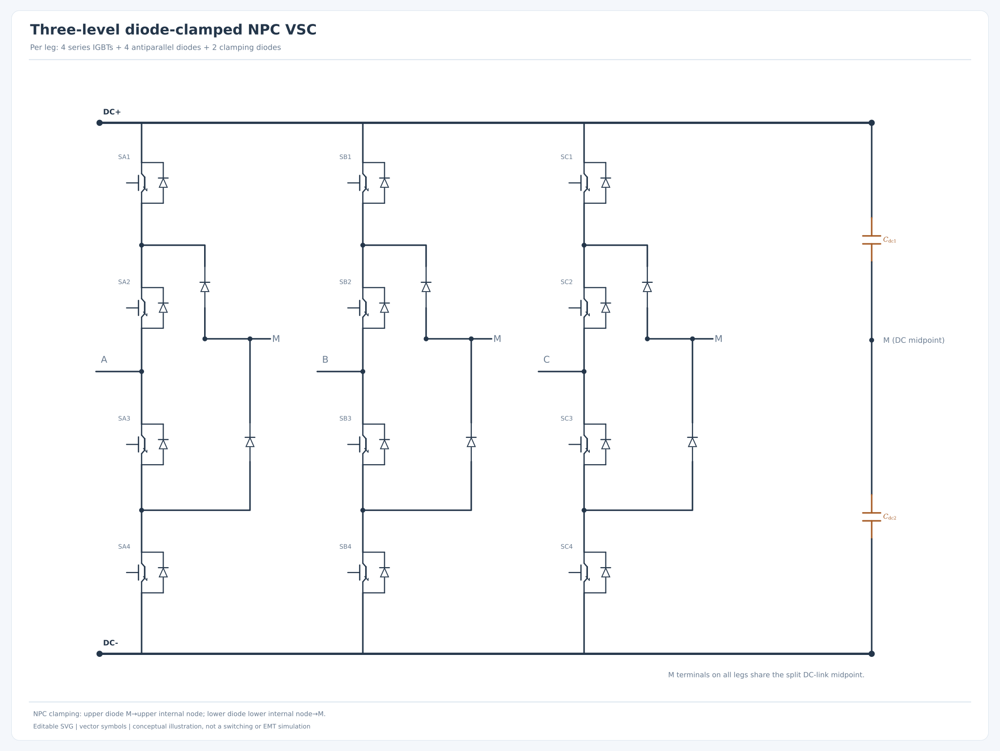

# FACTS STATCOM — reusable Python vector schematics

**STATCOM / STATCON** electrical diagrams created with Python. The project is a **standalone, editable-SVG schematic generator**, with structural netlist checks and reusable components. It is designed to remain API- and style-compatible with [facts-svc](https://github.com/angelohafner/facts-svc), without importing from or modifying that repository.

**Important:** These are **educational circuit drawings**, not load flow, EMT or switching simulations. Gate controls, DC voltages, power ratings, modulation and dynamics are not solved.

## Gallery

| Example | Vector diagram | Scope |
| --- | --- | --- |
| Basic STATCOM | [basic.svg](examples/gallery/basic.svg) | Grid, optional transformer, three reactors, VSC block and DC capacitor |
| Two-level VSC | [two-level.svg](examples/gallery/two-level.svg) | Three complete legs: six IGBTs and six reverse diodes |
| Three-level NPC | [npc.svg](examples/gallery/npc.svg) | Twelve IGBTs, reverse diodes, six clamping diodes, split DC bus |
| CHB star | [chb-star.svg](examples/gallery/chb-star.svg) | Two full-bridge cells per phase, common AC neutral |
| CHB delta | [chb-delta.svg](examples/gallery/chb-delta.svg) | Branches A–B, B–C and C–A with isolated cell capacitors |
| MMC (double star) | [mmc.svg](examples/gallery/mmc.svg) | Six arms, half-bridge submodules, arm reactors and floating DC rails |
| Complete interface | [complete.svg](examples/gallery/complete.svg) | Grid, coupling transformer/reactors, labeled phase ports and detailed 2L VSC |
| dq controller | [control.svg](examples/gallery/control.svg) | PLL, sensors, outer loops, dq current control, PWM and converter |

Open the [HTML gallery](examples/gallery/index.html) locally to compare all eight figures. SVG layers, symbols, labels and text remain editable with **Inkscape**.

### Full three-level NPC example



## Installation

Python 3.10+ (Windows, Linux, macOS):

```bash
python -m pip install -e .
```

No mandatory third-party dependencies are required. For PNG export:

```bash
python -m pip install -e '.[png]'
```

## Usage

```bash
# All eight reference schematics, as editable SVGs
python -m facts_statcom --all --output-dir output

# One diagram
python -m facts_statcom --preset npc --output-dir output

# Both vector and raster previews (requires CairoSVG)
python -m facts_statcom --preset two-level --format both

# User-specified configuration
python -m facts_statcom --config examples/chb_delta_3cells.json

# List diagram presets
facts-statcom --list-presets
```

The `output/manifest.json` records every generated figure and its configuration.

### Reusable Python API

```python
from dataclasses import replace
from facts_statcom import STATCOMRenderer, presets, build_netlist

config = replace(presets()["mmc"], submodules_per_arm=3)
netlist = build_netlist(config)
print(len(netlist.devices_of("igbt")))  # 36 IGBTs
STATCOMRenderer(config).save("output/custom_mmc.svg")
```

Custom JSON fields: `title`, `topology` (`basic`, `two-level`, `npc`, `chb`, `mmc`, `complete`, `control`), `transformer` (boolean), `cells_per_phase` (1–3), `submodules_per_arm` (1–3), `chb_connection` (`star` or `delta`). The module-count parameters currently apply to CHB and MMC diagrams, respectively.

## Package layout

```text
facts-statcom/
├── src/facts_statcom/
│   ├── model.py         # Immutable typed configurations
│   ├── netlist.py       # Electrically named nets and component terminals
│   ├── svg.py           # Compatible generic canvas/typography API
│   ├── symbols.py       # IGBT, diode, reactors, capacitors, cells
│   ├── renderer.py      # Schematic layouts and circuit composition
│   ├── cli.py           # JSON input and reproducible generation
│   └── __main__.py
├── examples/
│   ├── gallery/         # Eight actual vector SVGs + gallery page
│   └── *.json           # Configurable examples
├── docs/
│   ├── architecture.md
│   └── electrical-audit.md
├── tests/
│   ├── test_model.py
│   ├── test_netlist.py
│   └── test_renderer.py
└── .github/workflows/tests.yml
```

## Reuse strategy / compatibility with SVC

`SVGCanvas`, `Theme` and `node()` follow the same signature and scientific typography vocabulary used in [`facts_svc.svg`](https://github.com/angelohafner/facts-svc/blob/main/src/facts_svc/svg.py). Symbol generation is isolated from layouts. This library **does not import or copy SVC's SCR symbol** for IGBTs: the independently written transistor symbols have collector/emitter/gate and emitter-to-collector diodes. Both packages can later contribute their common drawing interfaces to a third, separate `power-diagrams-core` package without breaking existing CLI use.

Scalar variables (including Greek) are italic; descriptive/physical-unit text is roman; matrix typography uses bold upright text. SVG math is composed from editable `text` and `tspan` nodes. Code comments and docstrings are in English.

## Electrical interpretation

- **Two-level VSC:** three half-bridges in parallel across a shared split-free DC capacitor. For each IGBT, collector is the upper terminal; the antiparallel diode is oriented emitter-to-collector.
- **NPC:** each phase has four series devices; two clamp diodes connect the internal switch nodes to the *DC midpoint M*. The AC output is the connection between switches S2 and S3, **not M**. The local `M` labels all denote the **same** electrical net as the capacitor midpoint.
- **CHB:** each H-bridge comprises four switches and one **isolated** floating DC capacitor. Cascaded cell AC outputs are joined in series; phase arms may be joined in star or delta. Identical endpoint letters in the delta drawing designate common nodes, rather than a common DC bus.
- **MMC:** a double-star, chopper-cell-type conceptual topology is shown. Submodule arm port `A` is at the two-switch midpoint; arm port `B` is connected to capacitor negative. Each arm has a reactor. Floating DC rails `P` and `N` do **not** imply an external DC voltage source or a separate central capacitor.
- **Complete:** two separate drawing panels are linked by **matching phase net labels** to avoid unwanted wire crossings. Winding vector groups and ratings are intentionally unspecified.
- **Control:** an idealized d-axis voltage-oriented dq controller, with `i_d` primarily associated with DC energy balance and `i_q` with reactive power/AC voltage. Real controls require explicit power/current sign conventions, tuning and limits.

See [engineering audit](docs/electrical-audit.md) for detailed assumptions and test coverage.

## Test

```bash
python -m pip install -e '.[dev]'
python -m pytest -q
python -m facts_statcom --all --output-dir output
```

The CI workflow also runs the tests and batch SVG generation on Python 3.10, 3.12 and 3.13.

## Related work

- [facts-svc](https://github.com/angelohafner/facts-svc) — reusable SVC diagrams and SVG conventions.
- [three-phase-scr-rectifier-visualizer](https://github.com/angelohafner/three-phase-scr-rectifier-visualizer) — SCR rectifier / LCC representations and SVG editing conventions.

There are no repository-relative runtime dependencies; the packages can be installed independently.
