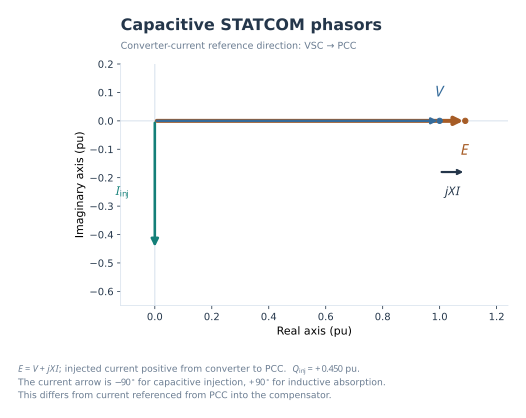
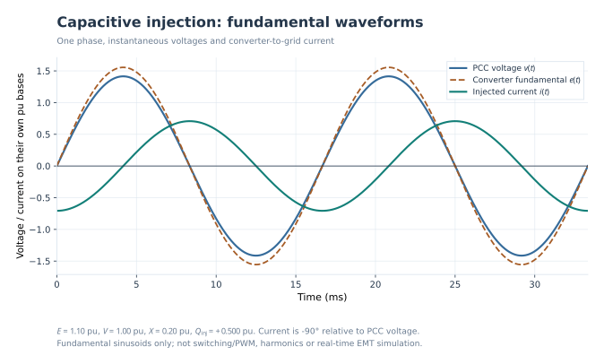
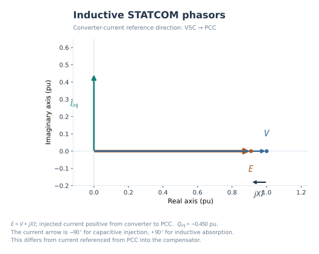
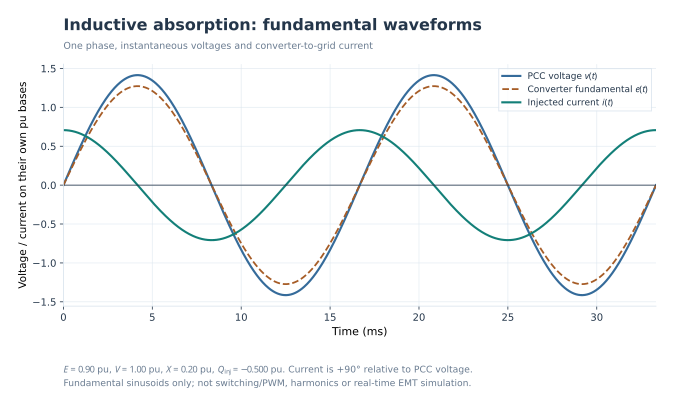
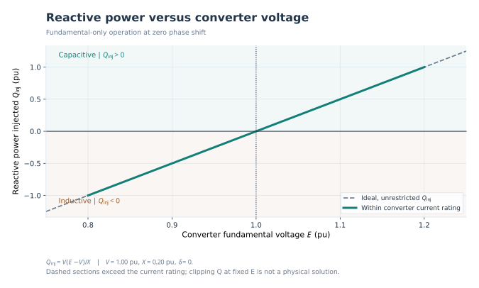
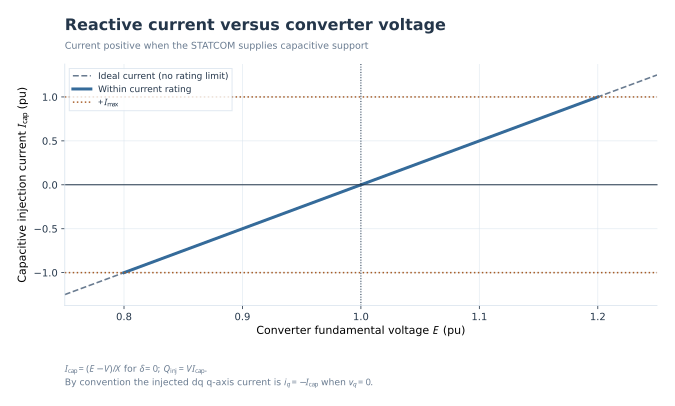

# Understanding STATCOM capacitive and inductive operation

**An illustrated, four-step lesson — fundamental-frequency idealization**  
**Audience:** Power-system engineering students and practicing electrical engineers.  
**Central question:** *How can a STATCOM supply or absorb reactive power by changing the magnitude of its converter's fundamental AC voltage?*

This lesson deliberately starts with an **electrical phenomenon**, not a gate-pulse diagram. All six plots below already exist in [`examples/operation/gallery/`](../examples/operation/gallery/) and are generated by the independent Python `facts_statcom.operation` models. The companion [offline interactive lesson](statcom-capacitive-inductive/index.html) adds a synchronized circuit, phasors, and waveforms.

## Conventions — read these first

- The PCC voltage phasor **V** is the angle reference: \(\underline V=V\angle 0^\circ\).
- **E** is the *fundamental, phase-RMS equivalent* voltage produced by the converter, **not** its PWM switching waveform or necessarily its DC-link voltage.
- **X** is the positive coupling reactance (the series reactor plus any equivalent transformer leakage). Resistive losses are neglected.
- **I_inj** is *positive from the converter toward the PCC*, for both capacitive and inductive cases. The arrow identifies the **reference**, not a permanent physical direction for an AC current.
- **P_inj** and **Q_inj** are three-phase power **injected at the PCC**. Positive \(Q_{\mathrm{inj}}\) means capacitive support; negative means inductive absorption.
- All numerical examples are balanced, sinusoidal, per-unit (pu), on consistent three-phase power and associated voltage/current/impedance bases. Their current phasors use a complex exponential/cosine reference; the waveform figures use a sine reference with the same *relative* phase angles.
- For all four steps, set \(\delta=\angle E-\angle V=0^\circ\). This removes steady-state active-power transfer from the **lossless** ideal model and isolates reactive power.

The two equations connecting all the pictures are:

\[
\boxed{\underline I_{\mathrm{inj}}=\frac{\underline E-\underline V}{jX}},\qquad
\boxed{\underline S_{\mathrm{inj}}=\underline V\,\underline I_{\mathrm{inj}}^*}
\]

With \(\delta=0^\circ\), they reduce to:

\[
\boxed{\underline I_{\mathrm{inj}}=-j\frac{E-V}{X}},\qquad
\boxed{Q_{\mathrm{inj}}=\frac{V(E-V)}{X}}.
\]

## Step 1 — The equivalent circuit: why does a voltage difference produce current?

**Question:** *What does the coupling reactor do?*

Imagine two ideal AC sources connected through an inductor. The source on the **left** represents the converter's fundamental AC voltage **E**. The source on the **right** is the PCC voltage **V**. Their lower terminals share a common reference. There is no direct short between voltage sources because the reactor has reactance **X**. When the two source phasors differ, that difference is applied to **X**, creating an AC current.

1. If \(E=V\), the voltage difference across the reactor is zero: \(I_{\mathrm{inj}}=0\). There is no fundamental reactive exchange in the ideal model.
2. If \(E>V\), the reactor voltage points from **V** toward **E** along the real phasor axis; because division by \(j\) rotates a phasor by **−90°**, the injected current phasor points down.
3. If \(E<V\), the voltage-difference phasor reverses; injected current points up instead.

**Observe first:** Increasing only the fundamental converter voltage changes both the magnitude **and the sign** of the reactive current. **Do not confuse** the converter fundamental voltage with the DC capacitor voltage. The VSC modulation and DC-link dynamics are outside this lesson.

**Checkpoint:** If \(E=V\), what voltage appears across the equivalent reactor? Why does the current vanish?

## Step 2 — Capacitive mode: higher converter voltage, positive Q injection

**Question:** *Why does the STATCOM supply reactive power when* \(E>V\)*?*

Use the same reference circuit. Set \(V=1.00\,\mathrm{pu}\), \(X=0.20\,\mathrm{pu}\), and \(E=1.10\,\mathrm{pu}\).

\[
\underline I_{\mathrm{inj}}=\frac{1.10-1.00}{j\,0.20}=-j\,0.50\,\mathrm{pu},
\qquad Q_{\mathrm{inj}}=1.00\cdot(+0.50)=+0.50\,\mathrm{pu}.
\]

*Figure 1 — Original `phasor-capacitive.svg`. **E** extends beyond **V**. The injected current is on the **negative imaginary axis**; \(jXI\) runs from the tip of **V** to the tip of **E**. The figure uses converter-to-PCC current.*

*Figure 2 — Original `waveforms-capacitive.svg`. The converter's fundamental voltage has the same phase but a higher amplitude than the PCC voltage. The green injected-current waveform is **−90°** relative to PCC voltage under the stated current reference. These are sinusoidal fundamental signals, not PWM/EMT currents.*

**Follow the visual argument:** higher \(E\) → positive phasor difference \(E-V\) → downward current phasor \(I_{\mathrm{inj}}\) → \(\operatorname{Im}(S_{\mathrm{inj}})>0\) → **capacitive support**.

**Important convention trap:** With injected current *toward the grid*, capacitive operation appears as **−90°**. With **the opposite passive reference** (current entering the STATCOM from the PCC), the reference current flips by 180°, so the corresponding phase-angle description is **+90°**. Specify the current arrow before discussing leading and lagging.

**Checkpoint:** In Figure 1, why is the current arrow downward rather than upward?

## Step 3 — Inductive mode: lower converter voltage, negative Q injection

**Question:** *What reverses if the converter makes less fundamental AC voltage than the PCC?*

Only change \(E\) from \(1.10\) to \(0.90\,\mathrm{pu}\). Keep \(V\), \(X\), \(\delta\), and the current reference unchanged.

\[
\underline I_{\mathrm{inj}}=\frac{0.90-1.00}{j\,0.20}=+j\,0.50\,\mathrm{pu},
\qquad Q_{\mathrm{inj}}=1.00\cdot(-0.50)=-0.50\,\mathrm{pu}.
\]

*Figure 3 — Original `phasor-inductive.svg`. **E** is shorter than **V**. The voltage difference reverses, so injected current moves to the **positive imaginary axis**.*

*Figure 4 — Original `waveforms-inductive.svg`. The converter fundamental voltage now has lower amplitude than the PCC voltage. Injected current is **+90°** relative to PCC voltage. Its magnitude is the same as Figure 2, but its polarity/phase is reversed.*

**Follow the visual argument:** lower \(E\) → negative phasor difference \(E-V\) → upward current phasor \(I_{\mathrm{inj}}\) → \(\operatorname{Im}(S_{\mathrm{inj}})<0\) → **inductive absorption**.

**Checkpoint:** Compare Figures 1 and 3. Which phasors keep their angle, and which phasor reverses direction?

## Step 4 — From one mode to the other: E is the control variable

**Question:** *Does the STATCOM switch abruptly between two fixed Q levels?*

For the ideal, in-phase equivalent circuit, **no**. The value of \(Q_{\mathrm{inj}}\) moves continuously with \(E\):

\[
Q_{\mathrm{inj}}(E)=\frac{V}{X}(E-V),\qquad
I_{\mathrm{cap}}(E)=\frac{E-V}{X}=\frac{Q_{\mathrm{inj}}}{V}.
\]

Here \(I_{\mathrm{cap}}\) is a **scalar** that is positive for reactive support. It is *not* the imaginary coordinate of \(\underline I_{\mathrm{inj}}\): that coordinate is \(-I_{\mathrm{cap}}\).

*Figure 5 — Original `reactive-power-vs-e.svg`. Left of \(E=V\) is inductive, at the crossing there is no exchange, and right of the crossing is capacitive. Dashed segments lie **outside** the nominal current rating; they are hypothetical points, not feasible commands.*

*Figure 6 — Original `reactive-current-vs-e.svg`. The current changes linearly with \(E\) in this ideal model; crossing zero reverses the current phasor. This scalar current is defined positive in the capacitive direction.*

**One controlled comparison** (\(V=1.00\,\mathrm{pu}\), \(X=0.20\,\mathrm{pu}\), \(\delta=0^\circ\)):

| Converter voltage \(E\) | Injected current phasor \(\underline I_{\mathrm{inj}}\) | Reactive power \(Q_{\mathrm{inj}}\) | Physical interpretation |
| ---: | ---: | ---: | --- |
| 0.90 pu | +j 0.50 pu | −0.50 pu | Inductive absorption |
| 1.00 pu | 0.00 pu | 0.00 pu | Zero ideal reactive exchange |
| 1.10 pu | −j 0.50 pu | +0.50 pu | Capacitive injection |

### Rating boundary: don't mistake an equation for an operating guarantee

The equivalent-circuit equations alone do not enforce the converter current rating. If \(|\underline I_{\mathrm{inj}}|>I_{\max}\), the requested point is **outside the allowed region**. It is not correct to clip \(Q\) to \(V I_{\max}\) while simultaneously claiming that the unchanged \(E\) remains the actual converter fundamental phasor. Finite DC-link voltage and modulation headroom may impose additional constraints. The original Python plots mark out-of-rating portions as **dashed**; the HTML lesson does the same.

### What this model does not claim

Real STATCOM control regulates reactive current through switching, a DC-link system, and current/voltage loops; it also draws enough active power to cover losses. Here, \(\delta=0^\circ\) and resistive losses are omitted so \(P_{\mathrm{inj}}=0\) by construction. These diagrams do **not** calculate harmonic distortion, switching dynamics, PLL response, current-control transients, faults, or power flow in a real network. They show *why fundamental reactive exchange changes sign*.

## Final mental picture

Imagine slowly moving one slider **E** from 0.90 to 1.10 pu while leaving **V** and **X** untouched. In a *single view*, watch the circuit's voltage difference, the current arrow in the phasor plane, and the current sinusoid. At \(E=V\), the current shrinks to zero; on the other side, the same sinusoidal fundamental comes back with **opposite phase**. That is the central physical insight.

**[Open the offline HTML learning laboratory](statcom-capacitive-inductive/index.html)** — the *Equivalent circuit*, *Phasor diagram*, and *Fundamental waveforms* are placed **side by side** under one master \(E\) slider; the \(Q(E)\) and \(I(E)\) graphs provide the associated operating-point checks.

## Sources and reproducibility

- Existing SVG figures: `examples/operation/gallery/` in this repository.
- Existing equations, sign conventions, tests and limits: [`docs/operation.md`](operation.md), `src/facts_statcom/operation/physics.py`.
- This is an independently prepared educational lesson, **not an official Siemens PTI document**.
